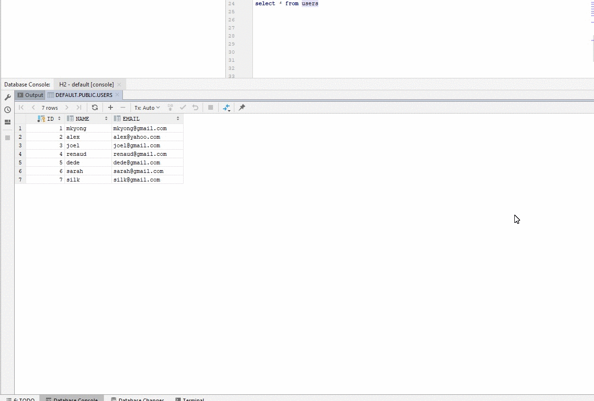
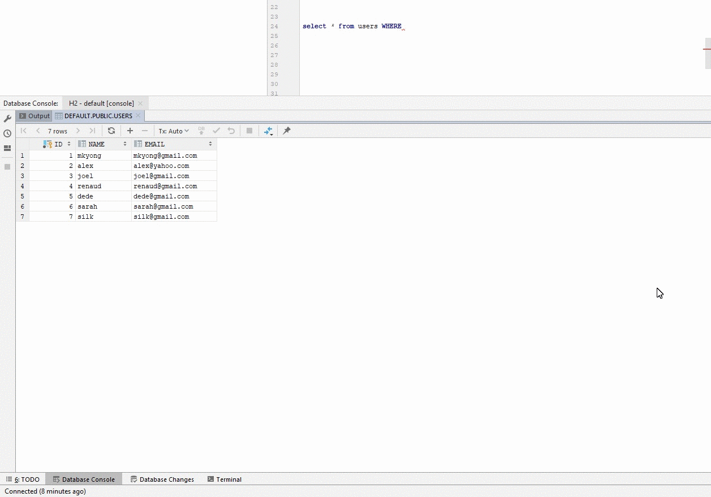
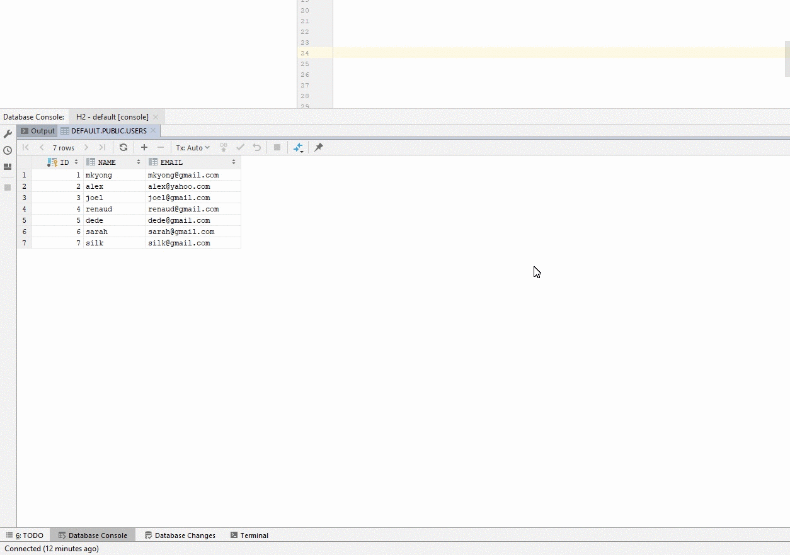

# Copy-as-SQL
IntelliJ Plugin for Ultimate Edition and DataGrip that allows you to copy SQL query results as SQL clauses and put them in the clipboard.

## Description
This plugin adds three options to the context menu when you right-click on selected data in a query result:
- Copy as SQL WHERE Clause
- Copy as SQL IN Clause
- Copy as SQL INSERT Clause

## Installation
- In IntelliJ IDEA Ultimate or DataGrip, go to Settings/Preferences > Plugins
- Click "Marketplace" and search for "Copy as SQL"
- Click "Install" and restart the IDE

## Requirements
- IntelliJ IDEA Ultimate Edition or DataGrip
- Database plugin enabled

## Supported SQL Types
- INTEGER, VARCHAR, DECIMAL, SMALLINT, TIMESTAMP, CHARACTER
- Other types are computed as VARCHAR

## Usage

### Copy as WHERE Clause
Select data in your query results and right-click to copy as a WHERE clause.

### Copy as IN Clause
Select data in your query results and right-click to copy as an IN clause.

### Copy as INSERT Clause
Select data in your query results and right-click to copy as an INSERT clause.

## Version History
- 1.0.5 - Fix Compatibility with 2022.2
- 1.0.4 - Remove deprecated API usages
- 1.0.3 - Add support for DECIMAL, SMALLINT, TIMESTAMP, CHARACTER. Other types are computed as VARCHAR.
- 1.0.0 - Initial release with support for INTEGER and VARCHAR.
